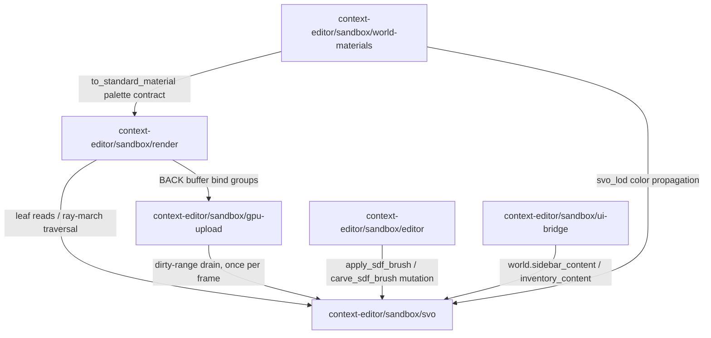

&lt;!-- aligned-structure:v2 --&gt;

# context-editor sandbox

## Motivation

The `context-editor-kernel` crate and its `sandbox-app` wrapper (Bevy 0.18 /
wgpu 27.0.1 / Dioxus 0.7) have no canonical spec today — a full-text search
for `context editor sandbox SVO Bevy voxel` against the active spec store
returned zero matches before this root was created (see [ARTIFACTS.md §4](../../../transcripts/18-09-2026_context-editor-sandbox-architecture/ARTIFACTS.md)).
[ticket 7205c1e1](../../../context-engine/context-stack/tools/context-editor/.workflow-tools/ticket/tickets/7205c1e1-273e-46f8-afd1-bf599a50e344/ticket.toml)'s
characterization pass is the first durable record of the kernel's 11 public
modules, their coupling, and their cross-module contracts; this root and its
children turn that one-time characterization into a maintained contract that
[ticket 26105679](../../../context-engine/context-stack/tools/context-editor/.workflow-tools/ticket/tickets/26105679-6b9b-4e0f-b950-87fcf743e492/ticket.toml) (restructure),
[ticket 9d754852](../../../context-engine/context-stack/tools/context-editor/.workflow-tools/ticket/tickets/9d754852-42f7-49cd-a631-d399699ca9d0/ticket.toml) (defect fixes),
and [ticket e4ff45b1](../../../context-engine/context-stack/tools/context-editor/.workflow-tools/ticket/tickets/e4ff45b1-996c-4de5-889c-d694c757708c/ticket.toml) (stretch-prototype gate)
can all trace against instead of re-deriving from source.

## Dependent expectation

If this spec hierarchy is implemented and kept current, dependents (restructure
work, defect-fix work, the stretch-prototype feasibility gate, and any future
crate-split decision) can rely on: (1) an authoritative list of which kernel
module boundaries are load-bearing versus extractable, (2) a durable
description of the cross-module contracts that any restructure must preserve
(SVO dirty-range drain, render-graph node order, palette→material sync, the
Dioxus/`SandboxWorld` bridge), and (3) a component relationship map that names
every child spec and its consumer/provider edges without needing to re-read
kernel source to reconstruct that map.

## Guards

This root spec is a composition contract only; it owns no per-component
acceptance criteria and is gated on structural composition validity, not
runtime behavior:

- [`context-editor-kernel-native-tests`](../../../.workflow-tools/test/specs/context-editor-kernel-native-tests.json) — `cargo test -p context-editor-kernel` (native baseline; 389 tests passing per [ticket 7205c1e1 part b7664292](../../../context-engine/context-stack/tools/context-editor/.workflow-tools/ticket/tickets/7205c1e1-273e-46f8-afd1-bf599a50e344/parts/b7664292-1ede-4938-b34c-3f5b2878e14b.md) §4).
- [`context-editor-kernel-wasm-check`](../../../.workflow-tools/test/specs/context-editor-kernel-wasm-check.json) — `cargo check --target wasm32-unknown-unknown -p context-editor-kernel` (closes the wasm/native parity gap W1 flagged as unresolved in §3 of that same part).
- [`context-editor-sandbox-app-trunk-build`](../../../.workflow-tools/test/specs/context-editor-sandbox-app-trunk-build.json) — `trunk build` for `sandbox-app`.

Each child spec below declares the same three guards plus any
component-specific guard it needs; execution results are pending as of this
spec's creation (specs were created this pass, not yet run against a fresh
kernel change — see each child's Evidence section for the last confirmed run).

## Positions

- **implemented** — the kernel/sandbox-app crate split itself (`code_ref`: [kernel/Cargo.toml](../../../context-engine/context-stack/tools/context-editor/kernel/Cargo.toml), [sandbox-app/Cargo.toml](../../../context-engine/context-stack/tools/context-editor/sandbox-app/Cargo.toml)), all 11 `pub mod` kernel modules and their 28 registered plugins (`code_ref`: [kernel/src/lib.rs](../../../context-engine/context-stack/tools/context-editor/kernel/src/lib.rs)).
- **not-implemented** — mesh extraction/marching cubes/meshlets, multi-bounce path tracing, a voxel texture/normal-map/parallax material system, and any automated visual-capture harness (`code_ref`: none exists; confirmed absent by targeted grep in [ARTIFACTS.md §3](../../../transcripts/18-09-2026_context-editor-sandbox-architecture/ARTIFACTS.md)). Do not treat these as implemented anywhere in this hierarchy.
- **partial** — wasm/native feature parity for `launch()`/`build_kernel_app()` (`code_ref`: [kernel/src/lib.rs](../../../context-engine/context-stack/tools/context-editor/kernel/src/lib.rs) lines with `#[cfg(target_arch = "wasm32")]` splits); native test runs to date exercised only the non-wasm32 no-op stubs, per W1 §3.

## Governing-rule requirement

Introduction of this spec and its children in-session must be governed by a
PolicyRule conditioned on the readiness statuses above; no such rule exists
yet as of this spec's creation, and creating it is out of scope for this
single-session waypoint (spec authoring only, no guidance/rule change per the
W2 non-goals in [02-author-spec-contract.md](../../../transcripts/18-09-2026_context-editor-sandbox-architecture/02-author-spec-contract.md)).

## Reading Order

1. [context-editor/sandbox/svo](context-editor/sandbox/svo) — the SVO data-authority contract every other child depends on.
2. [context-editor/sandbox/render](context-editor/sandbox/render) — the render-graph and splat-derivation contract consuming SVO and GPU upload.
3. [context-editor/sandbox/gpu-upload](context-editor/sandbox/gpu-upload) — the double-buffer upload bridge connecting SVO to render.
4. [context-editor/sandbox/editor](context-editor/sandbox/editor) — the SDF paint/carve/undo contract mutating SVO.
5. [context-editor/sandbox/ui-bridge](context-editor/sandbox/ui-bridge) — the Dioxus/`SandboxWorld` bridge and its 9 UI submodules.
6. [context-editor/sandbox/world-materials](context-editor/sandbox/world-materials) — the palette/LOD contract consumed by `sandbox-app`.
7. [ticket 7205c1e1 part b7664292](../../../context-engine/context-stack/tools/context-editor/.workflow-tools/ticket/tickets/7205c1e1-273e-46f8-afd1-bf599a50e344/parts/b7664292-1ede-4938-b34c-3f5b2878e14b.md) — the authoritative characterization this whole hierarchy is derived from.
8. [spec-system.instructions.md](../../../workflow-tools/spec/.agents/instructions/spec/spec-system.instructions.md) — the governing authoring rule for this hierarchy's structure.

## Component Relationship Map

## Shared Invariants

1. **SVO is the single source of truth for world geometry.** Every child
   (`render`, `gpu-upload`, `editor`, `world-materials`) reads or mutates
   `svo::VoxelWorld` directly; no child may introduce a second authoritative
   geometry representation without updating this map and the `svo` child.
2. **`take_dirty_ranges()` is drained exactly once per frame** by
   `svo::upload::SvoUploadPlugin`, which writes into the `gpu` module's BACK
   buffer. Any restructure (W5) or capture harness (W3) must preserve this
   invariant; `svo/upload.rs`'s own unit tests assert the post-drain
   empty-range regression guard.
3. **The render-graph node order is fixed**: `BufferSwap → ParticleCompute →
   SvoRayMarch → DepthBridge → UiComposite → WireframeOverlay`. `DepthBridge`
   depends on `SvoRayMarch`'s NDC-depth output; `WireframeOverlay` draws last
   with depth testing against the composited result.
4. **`launch()` sets the global `SandboxWorld` exactly once** and panics on a
   second call; `build_kernel_app()` assembles all 28 plugins with no
   world-specific resources, so any `SandboxWorld` implementor (not only
   `sandbox-app`) is responsible for inserting `VoxelWorld` and bootstrap
   systems before running the app.

## Examples

A restructure session (W5) that wants to know whether it may extract
`multiplayer` or `simulation` into a separate crate reads this root's
Component Relationship Map, finds neither module listed as a child (because
W1 classified both as "candidate boundary, not load-bearing, not decided
here"), and correctly concludes this hierarchy makes no claim about them —
it must re-derive their status from [ticket 7205c1e1 part b7664292](../../../context-engine/context-stack/tools/context-editor/.workflow-tools/ticket/tickets/7205c1e1-273e-46f8-afd1-bf599a50e344/parts/b7664292-1ede-4938-b34c-3f5b2878e14b.md)
§1 directly rather than assuming this spec silently covers them.

## Evidence

- [ticket 7205c1e1 part b7664292](../../../context-engine/context-stack/tools/context-editor/.workflow-tools/ticket/tickets/7205c1e1-273e-46f8-afd1-bf599a50e344/parts/b7664292-1ede-4938-b34c-3f5b2878e14b.md) — the sole source for every module classification and cross-module contract cited above.
- [ARTIFACTS.md §3-4](../../../transcripts/18-09-2026_context-editor-sandbox-architecture/ARTIFACTS.md) — confirms zero prior spec existed and lists the absent (not-implemented) surfaces.
- Validation: `./workflow-tools/target/debug/spec.exe health context-editor/sandbox --workspace .` and `./workflow-tools/target/debug/spec.exe refs context-editor/sandbox validate --workspace .`, both run from the repository root as part of this same authoring pass.

## Scope

In scope: the `context-editor-kernel` crate's public module boundaries, their
cross-module contracts, and the kernel→`sandbox-app` contract surface
(palette, `SandboxWorld`, entry point). Out of scope: any crate-split
decision (deferred to [ticket 26105679](../../../context-engine/context-stack/tools/context-editor/.workflow-tools/ticket/tickets/26105679-6b9b-4e0f-b950-87fcf743e492/ticket.toml)),
any stretch-prototype feature (deferred to [ticket e4ff45b1](../../../context-engine/context-stack/tools/context-editor/.workflow-tools/ticket/tickets/e4ff45b1-996c-4de5-889c-d694c757708c/ticket.toml)),
and the `multiplayer`/`simulation`/`physics`/`net` modules W1 classified as
candidate-boundary or keep-only rather than load-bearing (no child spec
covers them; see Examples above).